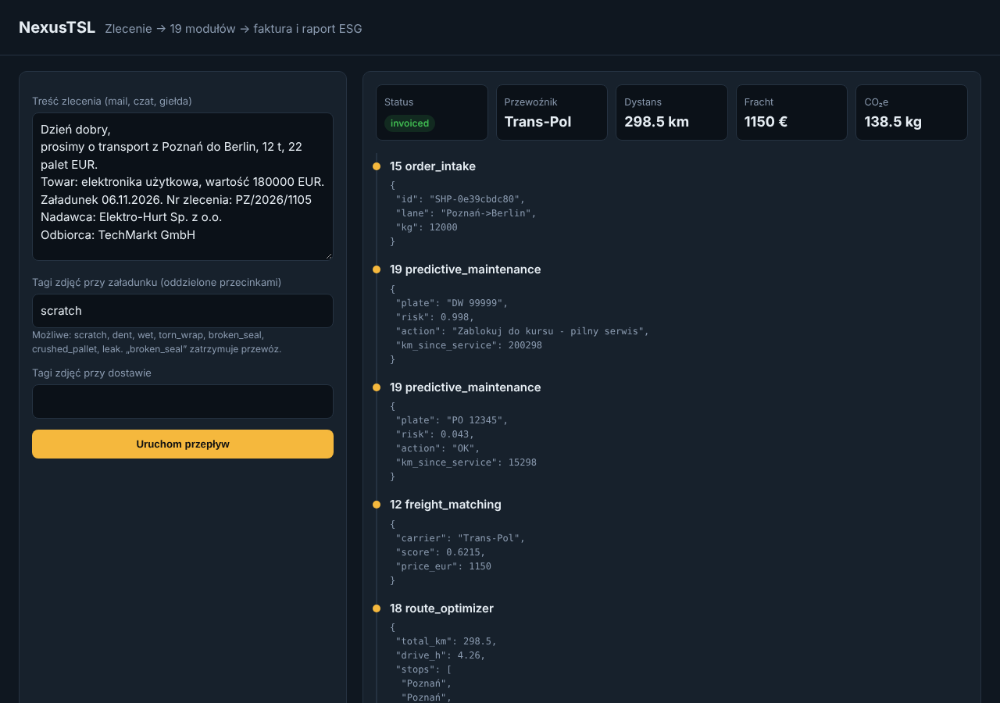
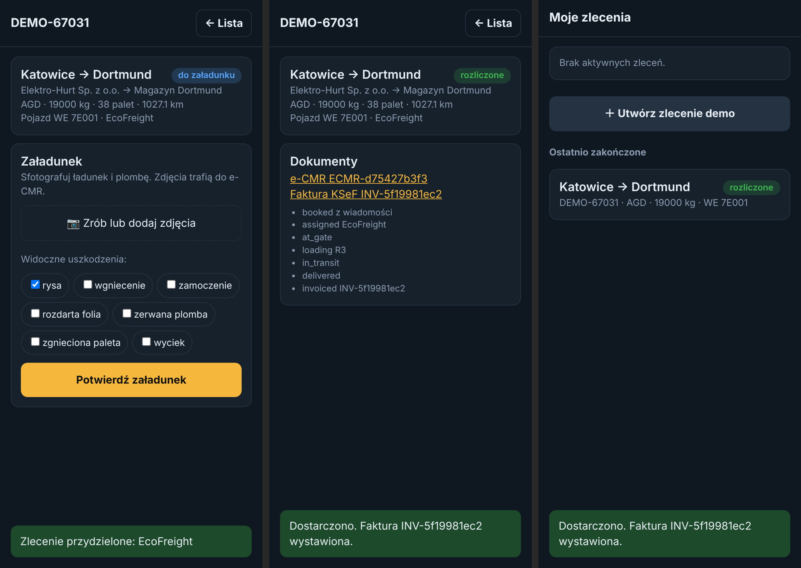

# NexusTSL 🚛🤖

[](https://github.com/Volers321/nexus-tsl/actions/workflows/ci.yml)


**Zintegrowana platforma AI dla transportu, spedycji i logistyki.** Jeden przepływ danych od maila ze zleceniem do faktury i raportu ESG, realizowany przez 19 współpracujących modułów.

🌐 **Demo na żywo: [nexus-tsl.onrender.com](https://nexus-tsl.onrender.com)** · [aplikacja kierowcy](https://nexus-tsl.onrender.com/driver) · [API](https://nexus-tsl.onrender.com/docs)

---

## O projekcie

NexusTSL to otwarty, modułowy prototyp systemu dla firm spedycyjnych, przewoźników i operatorów magazynów. Zamiast kilkunastu osobnych narzędzi, z których każde wymaga przepisywania tych samych danych, platforma prowadzi zlecenie przez cały cykl życia w jednym miejscu:

- **Przyjęcie zlecenia** – AI wyciąga z maila trasę, wagę, palety, wartość i referencję.
- **Planowanie** – wybór przewoźnika, kontrola stanu technicznego pojazdu, trasa, czas pracy kierowcy, paliwo lub ładowanie e-ciężarówki.
- **Dokumenty** – e-CMR z kryptograficznym łańcuchem podpisów i e-waybill z pełną historią stanów.
- **Obiekt** – brama z rozpoznawaniem tablic, przydział ramp, zadania dla pracowników, inspekcja zdjęć ładunku.
- **Kierowca** – aplikacja na telefon: zdjęcia ładunku, zgłoszenie uszkodzeń, pozycja GPS i podpis odbiorcy na ekranie.
- **Realizacja i rozliczenie** – śledzenie z ETA, faktura wystawiana automatycznie po potwierdzonej dostawie i eksportowana do XML KSeF FA(3).
- **Zrównoważony rozwój** – emisje CO₂e każdej przesyłki i raport Scope 3 dla klientów.

**Dla kogo:** dla zespołów IT w firmach TSL jako punkt wyjścia do własnego systemu, dla studentów i osób uczących się logistyki cyfrowej, dla każdego, kto chce zobaczyć, jak AI wpina się w realny proces przewozowy.

**Status:** prototyp (v0.2). Logika działa i jest pokryta testami, dane są zapisywane w SQLite, a część obliczeń to świadome uproszczenia (patrz [Ograniczenia](#ograniczenia-świadome-uproszczenia) i [roadmapa](docs/ARCHITECTURE.md#roadmapa)).

**Panel dyspozytora** (`/`): wklej zlecenie i zobacz jego przejście przez wszystkie moduły.



**Aplikacja kierowcy** (`/driver`): załadunek ze zdjęciami, dostawa z podpisem odbiorcy, dokumenty. Można ją dodać do ekranu głównego telefonu (PWA).



---

## Dlaczego jedna platforma?

Typowe narzędzia dla branży TSL rozwiązują pojedyncze wycinki procesu. W praktyce te same dane są w firmie przepisywane 5–10 razy: z maila do TMS, z TMS do listu przewozowego, z listu do faktury, z faktury do raportu ESG. NexusTSL ma **wspólny model domenowy** (`Shipment`, `Vehicle`, `Location`) i **szynę zdarzeń**, więc dane wpisane raz płyną przez wszystkie moduły.

```
 mail ─► [15] Intake AI ─► [12] Giełda ─► [19] Serwis? ─► [18] Trasa ─► [04] Czas pracy
      ─► [06] Paliwo │ [11] EV + [02] Energia bazy ─► [09] Ubezpieczenie
      ─► [03] e-CMR + [16] e-waybill ─► [10] Brama ─► [01] Rampa ─► [05] Zadania
      ─► [13] Inspekcja wizyjna ─► [14] Śledzenie/ETA ─► dostawa
      ─► [17] Faktura ─► [07] Emisje CO2e ─► [08] Raport ESG
```

## Moduły

| # | Moduł (`src/nexus_tsl/modules/`) | Co robi |
|---|---|---|
| 01 | `dock_scheduler.py` | Agent AI przydzielający rampy i kolejkę na placu, priorytety, rampy chłodnicze, KPI oczekiwania |
| 02 | `depot_energy.py` | Harmonogram ładowania e-ciężarówek w bazie: limit mocy, PV, taryfy |
| 03 | `ecmr.py` | e-CMR z łańcuchem podpisów nadawca→przewoźnik→odbiorca i wykrywaniem manipulacji |
| 04 | `driver_compliance.py` | Czas jazdy wg rozp. 561/2006: 4,5 h / 9 (10) h / 56 h / 90 h, planowanie przerw |
| 05 | `field_tasks.py` | Zadania dla pracowników mobilnych, dispatch wg kompetencji i odległości, potwierdzenia, rozliczenie |
| 06 | `fuel_optimizer.py` | Koszt paliwa trasy, wybór stacji z uwzględnieniem zasięgu i objazdu |
| 07 | `emissions.py` | Emisje CO2e WTW w duchu ISO 14083/GLEC, alokacja na przesyłkę |
| 08 | `esg_reporting.py` | Raport Scope 3 per klient i relacja, potencjał redukcji, eksport CSV |
| 09 | `cargo_insurance.py` | Polisa cargo per przesyłka, luka względem limitu CMR 8,33 SDR/kg |
| 10 | `gate_control.py` | Brama: ANPR z tolerancją błędów OCR, okna awizacji, audyt |
| 11 | `ev_fleet.py` | Wykonalność trasy e-ciężarówką, liczba ładowań, dopasowanie do przerw |
| 12 | `freight_matching.py` | Wielokryterialny ranking ofert przewoźników (cena, pusty przebieg, ocena, emisyjność) |
| 13 | `vision_inspection.py` | Inspekcja zdjęć ładunku/naczepy, werdykt i uwagi do e-CMR (tagi offline lub model wizyjny Claude) |
| 14 | `tracking.py` | Pozycje GPS, postęp, ETA, zdarzenie ryzyka opóźnienia |
| 15 | `order_intake.py` | Zlecenie z maila → strukturalna przesyłka (reguły PL/EN/DE + opcjonalnie Claude), [ewaluacja](evals/README.md) |
| 16 | `ewaybill.py` | E-waybill: maszyna stanów, wgląd dla stron w czasie rzeczywistym |
| 17 | `billing.py`, `ksef.py` | Faktura po potwierdzonej dostawie, dopłaty, postojowe, VAT 23% / 0%; eksport XML KSeF FA(3) zgodny z oficjalnym XSD |
| 18 | `route_optimizer.py` | Trasy wielopunktowe (najbliższy sąsiad + 2-opt), ETA; dystanse z [OSRM](docs/OSRM.md) lub przybliżenia |
| 19 | `predictive_maintenance.py` | Ryzyko awarii pojazdu, blokada kursu przy wysokim ryzyku |

## Demo online

Działająca wersja: **https://nexus-tsl.onrender.com**
- `/` – panel dyspozytora,
- `/driver` – aplikacja kierowcy (najlepiej na telefonie: „Dodaj do ekranu głównego”),
- `/docs` – interaktywna dokumentacja API.

Darmowa instancja usypia się po 15 minutach bez ruchu, więc pierwsze wejście trwa ok. 30–60 s. Dane demo znikają przy ponownym wdrożeniu. Każdy push na `main` aktualizuje demo automatycznie.

Własna kopia jednym kliknięciem:

[](https://render.com/deploy?repo=https://github.com/Volers321/nexus-tsl)

## Szybki start

```bash
git clone https://github.com/Volers321/nexus-tsl.git
cd nexus-tsl
python -m venv .venv && source .venv/bin/activate   # Windows: .venv\Scripts\activate
pip install -e ".[dev]"

python -m nexus_tsl.demo        # pełny przepływ zlecenia w konsoli
pytest                          # testy
uvicorn nexus_tsl.api:app --reload   # API → http://localhost:8000/docs
```

Albo w Dockerze:

```bash
docker compose up --build       # API na porcie 8000, baza w wolumenie
```

Z własnym serwerem tras OSRM: patrz [docs/OSRM.md](docs/OSRM.md).

### Przykład: zlecenie krok po kroku

```bash
API=http://localhost:8000
# 1. przyjęcie zlecenia z maila (wybór przewoźnika, trasa, dokumenty)
SID=$(curl -s -X POST $API/orders/book -H "Content-Type: application/json" \
  -d '{"text": "Transport z Poznań do Berlin, 12 t, 22 palet. Towar: elektronika, wartość 180000 EUR"}' | jq -r .shipment.id)
# 2. załadunek (brama, rampa, inspekcja zdjęć, podpis przewoźnika)
curl -s -X POST $API/shipments/$SID/load -H "Content-Type: application/json" -d '{"photos": [{"tags": ["scratch"]}]}'
# 3. pozycja GPS
curl -s -X POST $API/shipments/$SID/ping -H "Content-Type: application/json" -d '{"lat": 52.45, "lon": 15.0, "minute": 120}'
# 4. dostawa (podpis odbiorcy, faktura, emisje)
INV=$(curl -s -X POST $API/shipments/$SID/deliver -H "Content-Type: application/json" \
  -d '{"signer": "Anna Nowak"}' | jq -r .shipment.documents.invoice)
# 5. faktura w formacie KSeF
curl -s $API/invoices/$INV/ksef.xml
```

| Endpoint | Opis |
|---|---|
| `POST /orders/parse` | Tylko ekstrakcja pól ze zlecenia |
| `POST /orders/book` | Etap 1: przyjęcie, przewoźnik, trasa, ubezpieczenie, dokumenty |
| `POST /shipments/{id}/load` | Etap 2: brama, rampa, zdjęcia (base64), podpis przewoźnika |
| `POST /shipments/{id}/ping` | Etap 3: pozycja GPS, postęp, ETA |
| `POST /shipments/{id}/deliver` | Etap 4: zdjęcia, podpis odbiorcy, faktura, emisje |
| `POST /orders/run` | Wszystkie etapy naraz (demo) |
| `GET /shipments`, `GET /shipments/{id}` | Lista i szczegóły z historią kroków i zdarzeń |
| `GET /documents/ecmr/{id}` | e-CMR z weryfikacją łańcucha podpisów |
| `GET /invoices/{id}`, `GET /invoices/{id}/ksef.xml` | Faktura i jej XML KSeF FA(3) |
| `POST /compliance/check` | Kontrola dnia pracy kierowcy |
| `GET /distance?origin=&destination=` | Dystans drogowy (OSRM lub przybliżenie) |
| `GET /esg` | Raport emisji |
| `GET /events` | Dziennik zdarzeń szyny |

## Konfiguracja

Domyślnie wszystko działa **offline** (reguły i heurystyki), więc testy i demo nie wymagają kluczy API.

| Zmienna | Domyślnie | Opis |
|---|---|---|
| `NEXUS_DB_PATH` | `nexus.db` | Plik bazy SQLite (`:memory:` = bez zapisu) |
| `NEXUS_LLM_PROVIDER` | `offline` | `anthropic` = Claude pomaga w intake zleceń |
| `NEXUS_INTAKE_PREFER_LLM` | `0` | `1` = wynik modelu ma pierwszeństwo przed regułami ([dlaczego](evals/README.md)) |
| `NEXUS_VISION_PROVIDER` | `offline` | `anthropic` = Claude ocenia zdjęcia ładunku |
| `ANTHROPIC_API_KEY` | – | Klucz API (wymagany dla trybów `anthropic`) |
| `NEXUS_LLM_MODEL` | `claude-sonnet-5-5` | Model dla intake i wizji |
| `NEXUS_OSRM_URL` | – | Serwer tras OSRM, np. `http://osrm:5000` |
| `NEXUS_SELLER_NIP`, `_NAME`, `_ADDRESS`, `_IBAN` | przykładowe | Dane sprzedawcy na fakturze KSeF |
| `NEXUS_EUR_PLN` | `4.25` | Kurs do kwot VAT w PLN przy fakturze w EUR (użyj kursu NBP) |

LLM wymaga `pip install -e ".[llm]"`. Interfejsy `LLMProvider` (`core/llm.py`) i `Detector` (`modules/vision_inspection.py`) pozwalają podpiąć innych dostawców.

## Struktura

```
src/nexus_tsl/
├── core/            # model domenowy, szyna zdarzeń, baza SQLite, geografia/OSRM, warstwa LLM
├── modules/         # 19 modułów funkcjonalnych + eksport KSeF
├── static/          # panel dyspozytora i aplikacja kierowcy (PWA)
├── orchestrator.py  # przepływ w 4 etapach: book → load → ping → deliver
├── api.py           # REST API (FastAPI)
└── demo.py          # dane i scenariusz demonstracyjny
tests/               # testy jednostkowe, etapów, API i KSeF
evals/               # zestawy maili i ewaluacja AI
docs/                # architektura, roadmapa, OSRM
```

## Ograniczenia (świadome uproszczenia)

- Bez `NEXUS_OSRM_URL` dystanse liczone są z ortodromy × 1,25. Słownik miast obejmuje ~25 miast, a w produkcji potrzebne jest geokodowanie adresów.
- Współczynniki emisji są **orientacyjne**. Do raportowania zastąp je wartościami z GLEC Framework / KOBiZE.
- Kontrola czasu pracy obejmuje główne limity 561/2006, bez pełnej analizy tachografu (odpoczynki skrócone, prom/pociąg, praca w załodze).
- e-CMR używa SHA-256 jako demonstracji integralności. Ważność prawna wymaga podpisu/pieczęci eIDAS i dostawcy zgodnego z eFTI.
- Faktura KSeF jest generowana i walidowana, ale nie wysyłana do KSeF (wymaga uwierzytelnienia firmy w API KSeF 2.0).
- SQLite wystarcza dla jednej instancji. Przy wielu instancjach potrzebny jest PostgreSQL i kolejka zdarzeń (patrz roadmapa).
- Brak logowania i ról: demo jest otwarte, a aplikacja kierowcy pokazuje wszystkie zlecenia.

## Licencja

MIT, patrz [LICENSE](LICENSE).
