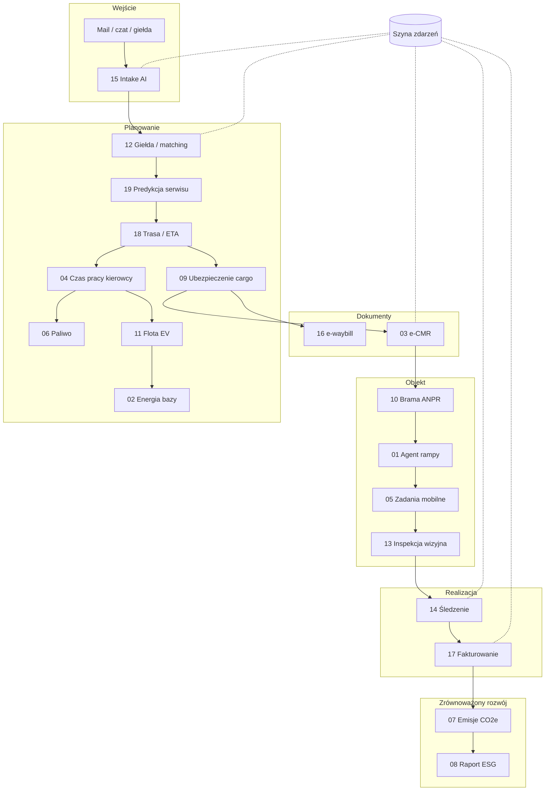

# Architektura NexusTSL

## Zasady

1. **Jeden model domenowy.** Każdy moduł przyjmuje i zwraca obiekty z `core/models.py`. Nie ma lokalnych kopii danych przesyłki.
2. **Moduły bez wzajemnych importów.** Moduły nie importują się nawzajem. Łączy je orkiestrator lub szyna zdarzeń, więc każdy można wymienić albo wydzielić do mikroserwisu.
3. **Offline-first, AI tam, gdzie daje przewagę.** Deterministyczne reguły to fundament i fallback. LLM i modele wizyjne wchodzą przez interfejsy (`LLMProvider`, `Detector`).
4. **Dokument jako stan.** e-CMR i e-waybill są źródłem prawdy o etapie przewozu. Faktura powstaje dopiero po kryptograficznie spójnym potwierdzeniu dostawy.

## Warstwy

## Zdarzenia

| Temat | Emiter | Przykładowi konsumenci |
|---|---|---|
| `shipment.booked` | intake | giełda, CRM |
| `shipment.assigned` | matching | brama (awizacja), tracking |
| `shipment.in_transit` | e-CMR | tracking, klient (powiadomienie) |
| `shipment.delay_risk` | tracking | rampa docelowa (przesunięcie slotu), klient |
| `shipment.delivered` | e-CMR | billing, ESG |
| `shipment.exception` | inspekcja | reklamacje, ubezpieczenie |
| `invoice.issued` | billing | księgowość / KSeF |

## Roadmapa

Zrobione w v0.2:
- [x] Trwałość: SQLite (magazyn dokumentowy, `core/storage.py`), stan etapów przeżywa restart
- [x] Przepływ etapami: `book → load → ping → deliver` z kontrolą kolejności
- [x] Routing: klient OSRM z buforowaniem i fallbackiem (`docs/OSRM.md`)
- [x] KSeF: eksport faktury FA(3), zgodny z oficjalnym XSD
- [x] Inspekcja: detektor na multimodalnym modelu Claude za interfejsem `Detector`
- [x] Aplikacja kierowcy (PWA)
- [x] Ewaluacja intake: zestaw rozwojowy + kontrolny, workflow z modelem (`evals/`)

Dalej:
- [ ] Uwierzytelnianie (OAuth2/OIDC) i role: spedytor, przewoźnik, kierowca, magazyn, klient
- [ ] PostgreSQL + SQLAlchemy/Alembic, szyna NATS/Kafka z outbox pattern
- [ ] Wysyłka do KSeF (API 2.0, środowisko testowe), odbiór UPO
- [ ] Optymalizacja: OR-Tools VRP z oknami czasowymi i ładownością
- [ ] e-CMR: podpis kwalifikowany eIDAS, format zgodny z eFTI
- [ ] Geokodowanie adresów (Nominatim) zamiast słownika miast
- [ ] Tachograf: import plików DDD
- [ ] Zestaw oznaczonych zdjęć uszkodzeń i ewaluacja modułu wizyjnego
- [ ] Tryb offline aplikacji kierowcy z kolejką wysyłek (Background Sync)
